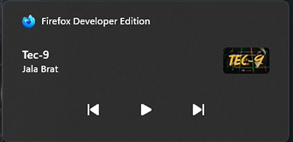
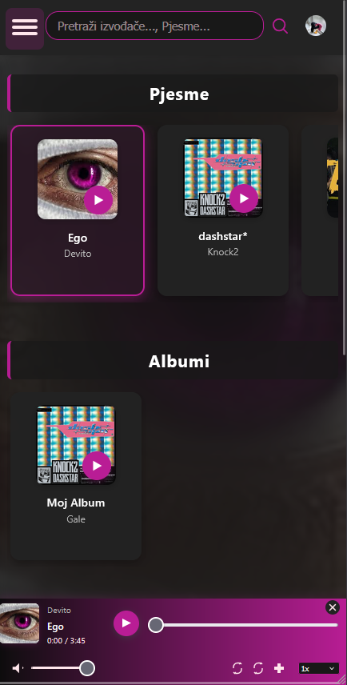
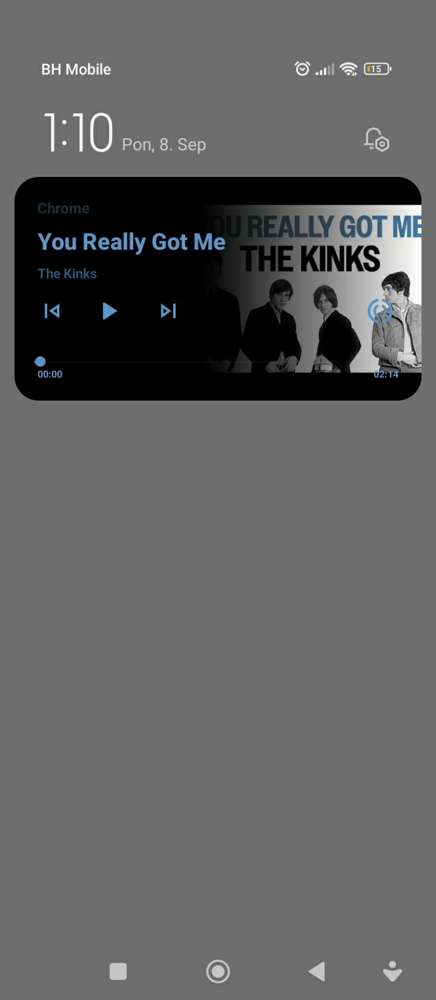
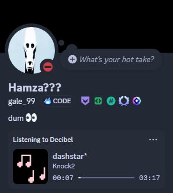
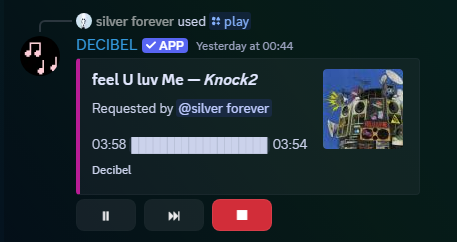
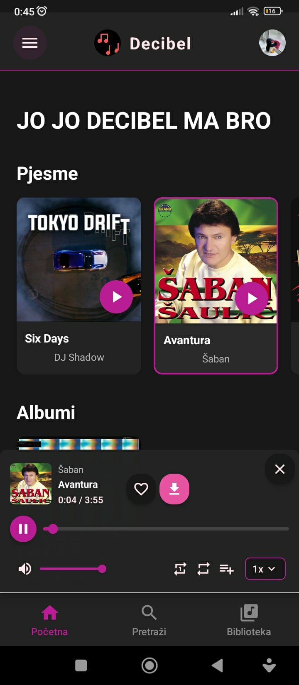

# Decibel

Decibel je moderna muzička platforma koja omogućava korisnicima da otkrivaju, slušaju i upravljaju pjesmama, albumima i playlistama, kao i da prate druge korisnike i izvođače. Projekat se sastoji iz tri dela: backend (FastAPI + MySQL), frontend (React + Vite), mobilne aplikacije (React-native) i desktop aplikacije (Electron).

- **Backend**: FastAPI, SQLAlchemy, async MySQL, Firebase Storage za fajlove.
- **Frontend**: React (TypeScript), Vite, CSS Modules, responzivan dizajn.
- **Mobilna aplikacija**: React-native.
- **Desktop**: Electron. 

Za više informacija, pogledaj kompletnu [dokumentaciju projekta](dokumentacija/Dokumentacija.md).

## Primjeri

**1. Web stranica desktop**

---

**2. Web stranica desktop Media Session**

---

**3. Web stranica mobitel**

---

**4. Web stranica mobitel Media Session**

---

**5. Desktop aplikacija**

---

**6. Desktop aplikacija Context Menu**

---

**7. Rich Presence Discord**

---

**8. Discord Bot**

---

**9. Mobilna Aplikacija**

